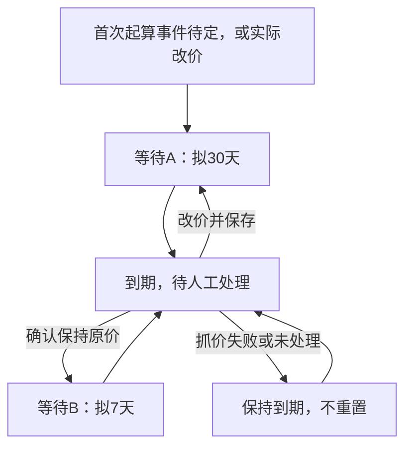

# 采购会计系统完整需求文档

**版本：V2.1｜更新日期：2026-11-13｜状态：完整需求讨论稿，尚未定稿**

本系统用于面向公司、单位客户的采购代办业务，以客户采购门户和内部经营后台贯通商品资料、采购需求、报价、订单、多地址配送、进销发票、成本利润和统计。网页支持电脑和手机浏览器使用，商品目录随实际业务逐步丰富。

**本轮10条回答全部按“当前设计意向”整理，不表示最终方案已经确定。** 本版将这些意向写回相关页面、模块、流程、分期与验收，替代V2.0中与之冲突的建议；同时保留仍需讨论的规则和原始意图，供下一轮校正。本文不是开发完成报告，也不是仅追加内容的补丁。

## 一、版本说明、需求状态与当前范围

### 1.1 版本变化

| 项目 | V2.1处理 |
|---|---|
| 客户与账号 | 当前面向公司／单位；后台发号；自助注册保留但关闭并提示；一公司一主账号，子账号未来预留 |
| 资金功能 | 按当前意向不设置收付款操作、独立资金流水及核销模块，不对接支付或网银；订单结清标记与利润依据仍待讨论 |
| 多购物袋 | 一次提交形成一个订单；一袋对应一个收件组；同公司结算、客户线下一次结清；全部确认收货即履约完成 |
| 发票与跨月 | 当前一销售订单一张有效销项发票；多个供应商的采购发票另行管理；开票、采购、发货可跨月，按各业务日期统计 |
| 商品与提醒 | 前期采购价管理员填写，供应商入驻及同步未来预留；A＝30天、B＝7天为拟定默认，可自定义；首次起算存在待讨论冲突 |
| 采购需求与报价 | 需求表分开提交文字、图片、链接、规格、数量，地址非必填；正式报价及专业展示页纳入当前意向；合同预留接口 |
| 复购与常购 | 历史整单再次下单保留在一期；自动常购清单改为成熟稳定后的待办 |
| 物流与UI | 保留双端物流查询，识别单号为候选、手选兜底；自送建议命名“商家自配送”；沿用柔和红色与现代交互 |
| 更新方式 | 仍输出完整文档；旧Q01—Q10记录答复进展，新的遗留问题改用R编号，避免把“有回答”等同于“已定稿” |

### 1.2 四类需求状态

- **既有要求**：此前已明确且本轮没有改变的目标，如无在线支付、多购物袋、整单复购先入购物车、双端物流、库存暂缓、柔和红色UI。
- **当前意向**：本轮用户正在梳理的设计想法。本版据此安排结构，但不把它们称为最终确认规则。
- **设计建议**：用于实现目标或解决冲突的推荐方式，等待用户判断。
- **待定／后续**：仍缺业务规则或明确延后的功能。旧方案与当前意向不同的地方明确写出，不混杂执行。

“功能保留”与“本期启用”分开。原本有过讨论的收付款、常购、个人客户等，不会因历史文档出现过就继续作为本版的当前实施要求。[B0][B1][B2][U3]

### 1.3 本版工作范围

| 领域 | 当前工作范围 | 状态 |
|---|---|---|
| 经营对象 | 公司／单位客户，联系人仍作为个人资料；原有独立个人客户场景暂不纳入当前使用范围 | 当前意向 |
| 采购来源 | 本地、外地供应商，京东／淘宝等客户提供或管理员维护的外部链接 | 既有要求与当前意向 |
| 商品资料 | 手工维护、文件导入，随采购补充目录；统一商品可有多个供应商供货记录 | 既有要求＋设计建议 |
| 客户下单 | 浏览货源、采购需求、购物车、多购物袋、整单复购、后台确认及采购配送 | 既有要求，需求与报价为当前意向 |
| 资金边界 | 线下公对公转账在系统外完成；不设置收付款操作、不做独立流水及金额核销 | 当前意向，延续无在线支付要求 |
| 经营记录 | 订单成交、采购成本、运杂费、税费、发票、交付及利润分析；利润依据未定 | 既有目标，具体核算待定 |
| 发票 | 进项／销项登记、附件、关联与状态；上传识别为条件增强，手填与人工核对兜底 | 当前意向＋设计建议 |
| 完成标准 | 客户全部确认货物无问题后，订单履约完成；后续未开票、未结清不阻断完成 | 当前意向 |
| 价格维护 | A/B提醒、日志、自定义周期保留；本轮默认值与首次起算分别标明 | 既有要求＋当前意向，部分待定 |
| 库存 | 完整库存暂缓，保留接口；采购和配送不强制依赖库存入库 | 既有要求 |
| 通用能力 | 权限隔离、附件、操作审计、导出、备份及恢复、电脑手机适配 | 既有规划，细节为设计建议 |
| 视觉 | 比火办网稍浅柔和的红色；现代标签页、悬停高亮、文字悬浮提示 | 既有要求 |

用户提出未来可能出售系统，因此可考虑配置和模块扩展；**这不自动等于本期建设多租户SaaS、收费会员、卡密激活或完整供应商入驻平台**。智慧记自动同步、历史迁移仍未提出。桌面封装、部署位置和维护方式后续选定。

## 二、参考证据范围

### 2.1 “客户易通”截图的使用边界

沿用V2.0对用户提供的18张后台截图的核对，包含工作台、客户、商机、报价、合同、订单、工单、供应商、采购、商品、财务、用户、角色、备份、审计和帮助等页面。收费会员截图仅用于识别排除范围，不纳入系统需求。[S01—S18]

截图能够证明当时展示的栏目、字段、入口和产品说明，不能证明完整业务已经实际跑通。空表、灰色按钮不等于功能不支持；只看到侧栏入口的功能不推断其完整规则。客户自助端、多购物袋、佣金和A/B价格检查在这组截图中**未展示**，不能据此断言原产品没有。

### 2.2 火办网的使用边界

2026-11-13核验了火办网公开、未登录页面，覆盖首页、分类列表、品牌中心、品牌商品列表与登录页。[W1—W5]

- 商品详情、购物车等访问触发登录跳转，因此没有核验登录后的详情、结算、我的订单、会员中心或商家后台。
- 首页的“项目智能报价、订单智能采购、物流时效速查”等入口真实链接到教学视频，按教学入口和业务主题记录，不描述为本轮已实测业务工具。
- 某分类列表本次显示0项结果，只能描述当次页面现象，不能据此认定无货或筛选不可用。
- 安兴集团官网及官方PDF补充火办网的归属和功能资料。PDF元数据创建日期为2023-09-12，共14页，属于历史官方材料，不能当作2026年后台现场核验。[W6][W7]

本次是功能与页面规划整合，尚未验证火办网、京东等平台的开放接口。基础货源支持手工维护及文件导入；自动同步、自动代下单不属于已接入或已确认可用的能力。

## 三、“客户易通”后台可借鉴的内容

| 参考模块 | 截图中实际展示 | 对本系统的处理 |
|---|---|---|
| 工作台 | 客户、跟进待办、月签单采购出库退货、待开票低库存供应商，应收实收应付及年度收入成本利润等卡片 | 借鉴待办与经营概览；改为代采、发票、成本和价格检查的重点，不照搬收付款指标，库存指标随库存模块暂缓 |
| 客户 | 编号、名称、级别、状态、标签、业务员、手机、最后跟进；搜索筛选、打印、导入导出 | 保留客户档案，建议增加轻量跟进、标签与待办；线索、公海池等仅看到入口，复杂CRM后续可选 |
| 商机 | 五阶段漏斗、预计成交、赢输单率及负责人报表 | 可供项目业务参考，普通复购不强制建立商机 |
| 报价 | 编号、日期、客户、业务员、金额、折扣、状态 | 正式报价已进入当前意向，版本、有效期及转订单为设计建议；不把每次普通下单变成报价审批 |
| 合同 | 编号、名称、类型、客户、起止日期、状态、金额、关联订单数 | 当前保留合同关联接口；完整合同附件、期限和多订单管理后续启用 |
| 销售订单 | “签单”编号、日期、客户、合同、业务员、金额、已收、欠款 | 借鉴订单台账，补待确认、采购、收货分组和物流；不照搬已收／欠款资金台账 |
| 工单 | 类型、客户、联系人、地址、预约、状态、师傅、费用；我的工单／工单池提到接单、签到、完工、抢待派单 | 当前先用售后与异常事项；外派师傅、抢单签到另列后续选项 |
| 供应商与采购 | 供应商档案及导入导出；采购单供应商、经办人、金额、已付、欠款、状态；说明确认入库后增加库存 | 借鉴采购台账与成本资料，适配直发和经手发货；不强制入库，不增加付款登记 |
| 商品与库存 | 图片、名称、型号、分类、单位、售价、库存、导入导出；侧栏有出库、退货、待入库、库存预警 | 借鉴商品字段与批量维护；仅有入口的仓库功能不视为已核验流程，库存仍暂缓 |
| 财务 | 流水日期、类型、金额、方式、关联单据、对方、备注，收款／付款／净额汇总；说明支持分批开票和多个PDF附件 | 吸收发票附件和业务关联参考；本版不吸收资金流水，也不把分批销项开票带入一单一票意向 |
| 用户与角色 | 内部账号启停、改密；管理员、业务员、调度员、师傅、财务、仓管等角色和菜单权限描述 | 区分内部账号与外部客户账号；本系统权限按实际操作和数据范围定义，不直接照抄角色 |
| 系统设置 | 字典、系统配置、自定义字段、工单类型、时效管家等侧栏入口 | 基础配置纳入原方案，自定义字段和复杂工单配置后续可选 |
| 备份与审计 | 备份开关、目录、间隔、保留份数、手动执行、大小时间状态；审计模块、操作人、时间、对象、摘要、结果等字段；页面说明支持差异对比，详情未展示 | 建议补充恢复流程和恢复验证；截图中24小时、保留3份只是参考值，恢复能力未展示 |
| 帮助说明 | 帮助页介绍本地化存储及通知依赖时效管家；备份页另提供NAS／服务器目录说明 | 作为部署与提醒的参考线索，不当作技术验证；需按客户外网访问和内置A/B提醒重新设计 |

截图事实与本版采纳范围分开列示；本轮调整采纳范围，不改写截图所显示的事实。来源文件在文末逐项列明。[S01—S18]

## 四、火办网页面构成与参考价值

| 页面／区域 | 本轮可见内容 | 建议吸收的部分 |
|---|---|---|
| 顶部导航 | 登录、注册、邀请码注册、我的订单、会员中心、商家中心、APP等入口 | 客户账号与订单入口清晰；本版注册暂关，不直接复制开放注册或邀请码机制 |
| 首页搜索区 | 品牌标识、关键词搜索、找同款、购物车；找同款操作要求登录 | 强化关键词搜索、购物车；找同款／图片识别不是一期默认能力 |
| 首页分类与内容 | 左侧办公分类，中部促销横幅，右侧MRO分类；下方品牌、品类、商品卡及促销／直发标签 | 采用清晰分类、品牌和履约提示；按自身货源逐步扩展分类，减少大促销区域 |
| 首页服务入口 | 项目报价、智能采购、物流时效、退货等教学视频入口；浮动客服、购物车、售后 | 将采购、物流、售后设计为可理解的业务入口；不把教学链接当作已验证自动化能力 |
| 分类列表 | 类目、克重、规格、包装筛选；销量／价格排序，价格范围、库存充足、配送地区、大图展示和商品数 | 参考规格筛选和列表操作；供货能力不能以未接库存的“库存充足”替代 |
| 品牌中心 | 搜索、A—Z及数字首字母、品牌入口 | 建议商品资料增加品牌，商品量增长后启用品牌检索 |
| 品牌商品列表 | 按目录分类、默认／销量／人气／价格排序、价区间、库存筛选、商品编码、收藏 | 参考商品编码、收藏、分类及排序；人气排序需先具备相应数据 |
| 登录页 | 账号密码、自动登录、找回密码、普通及邀请码注册入口 | 保留便捷登录及找回；本版采用后台发号，注册关闭提示，单位多账号未来预留 |

来源为本轮公开页面观察。[W1—W5]

**价格权限有一处值得特别注意：** 首页多数商品卡显示登录查看价格，但本轮在品牌商品列表仍看到一件商品的价格。因此不能概括为火办网全站“必须登录才能看价”。本系统应在列表、详情、搜索、购物车、导出及直接访问入口执行同一套客户价格权限。[W1][W4]

官方历史PDF描述了客户前台、经销商后台、商城后台，以及客户与商品维护、客户价格、账期额度、配送、签收、经营数据、对账开票和退换货等能力。对本系统的启发是把客户采购与内部执行贯通；支付提现、库存接入、平台营销及服务时效承诺不直接复制。PDF物理第9页和第13页分别对应印刷页08和12。[W7]

## 五、系统结构与完整页面地图

### 5.1 总体结构

采用“客户采购门户＋内部经营后台”统一维护商品、公司客户、采购需求、报价、销售与采购订单、履约、发票和经营数据。电脑适合批量处理，手机适合选购、改数量、查物流和快速处理待办。

普通复购走短流程；报价用于专业呈现商品和价格，合同保留扩展位置。前台显示客户自己的业务资料，后台保存供货来源、成本、内部说明和审计信息。不得因为取消资金流水而取消成本记录，也不得为了计算利润重新塞入收付款台账。

| 端／栏目 | 本版页面与职责 | 状态 |
|---|---|---|
| 客户：首页／商品 | 搜索、分类、商品列表详情；品牌、规格、单位包装与可见价格 | 既有要求，价格模式待定 |
| 客户：提交采购需求 | 文字、图片、独立链接字段、规格、数量；查看处理进展 | 当前意向 |
| 客户：报价 | 专业报价展示页、商品主图及系统商品链接、数量价格、查看和反馈 | 当前意向；确认方式待定 |
| 客户：购物车／购物袋 | 改数量、分组收件、地址簿、提交检查，一次提交一个订单 | 既有要求＋当前意向 |
| 客户：订单／物流 | 订单详情、各袋配送、快递轨迹、商家自配送、收货确认、再次下单 | 既有要求＋当前意向 |
| 客户：发票／资料 | 已上传销项发票及状态、订单资料导出、通知、可编辑的账号资料 | 当前意向，权限边界待定 |
| 客户：常购 | 暂不向客户展示，成熟稳定后再设计规则并启用 | 当前意向：后续待办 |
| 客户：注册／子账号 | 注册关闭并提示；子账号暂不开，未来提交须主账号审核 | 当前意向：预留 |
| 后台：工作台 | 待确认、待采购、配送异常、缺进项票／未上传销项票、待核对成本、到期查价 | 既有规划按当前意向调整 |
| 后台：基础资料 | 公司客户、主账号、供应商、商品、多来源供货、历史价、采购链接 | 核心范围 |
| 后台：需求／报价／订单 | 需求匹配、补充商品档案、专业报价、销售订单、采购单、合同关联预留 | 当前意向＋既有要求 |
| 后台：履约／发票 | 分袋分包配送、物流、自配送、客户收货确认、采购与销售发票上传绑定 | 核心范围 |
| 后台：票据与经营核算 | 发票资料、商品成本、运杂费及费用资料、利润待核算状态、按业务日期统计与导出 | 核算口径待定，数据保留 |
| 后台：系统 | 账号权限、A/B提醒、附件、操作日志、设置、导出、备份恢复 | 既有规划 |

**本版不设独立收款单、付款单、资金流水、收付款核销或网银对账页面。** 是否在订单上保留手工“已结清”标记仍待R01，不提前把它当作已确定功能。

## 六、客户采购门户完整需求

### 6.1 公司账号、注册关闭与资料编辑

**当前意向：** 客户对象为公司／单位，前期一个公司对应一个主账号，由管理员生成。自助注册保留接口，暂不开放；注册页面显示清楚提示，例如“自助注册暂未开放，请联系管理员开通账号”。提示文案为设计建议，关闭状态同时作用于提交入口，不能只是隐藏按钮。

客户可在账号后台修改允许编辑的资料。建议先开放联系人、联系方式、收货地址、密码等个人使用资料；具体字段清单见D02、D03。用户名拟每年可改一次，“自然年一次”还是“距上次修改满一年”尚待明确。

公司／单位的法定名称以及用于开票、合同的名称不能由客户自行修改。资料录错不能永久无解：建议由客户申请、管理员核对后纠正，记录修改前后值、依据、操作人和时间；历史合同、订单及已开票信息保持可追溯，不随主档案静默改写。

账号停用、找回密码与客户数据隔离继续保留。主账号、公司档案、联系人应有清楚对应关系，客户不得查看其他公司订单、成本、附件和价格资料。

### 6.2 公司子账号：未来预留

本期不开启公司多账户；保留未来一个主账号管理多个子账号的关系。按当前意向，子账号发起的业务需要主账号审核，并由主账号正式提交；不能让子账号绕过审核直接对外形成订单。

**设计建议：** 在后续订单、需求及报价反馈的显眼位置标注“由某子账号发起，主账号审核提交”，保留发起人、审核人、提交人和时间。用户所说“子账号的所有内容”具体涵盖哪些操作仍需后续细化，不把它扩展为本期复杂审批系统。后续设计建议：已审核的内容如果再次修改，应重新提交主账号审核，不能沿用旧批准直接提交变更内容。

### 6.3 商品浏览、资料与价格

保留商品图片、标题、文字描述、分类、品牌、型号、规格、单位包装、系统商品编码、当前可见价格、起订量、供货状态、搜索筛选及加入购物车。品牌和规格筛选按商品数量逐步启用；未接库存时不显示无依据的实时库存承诺。

**价格是本轮明确保留的待定项。** 固定价、客户价、协议价、询价、不同客户可见范围、有效期和改价确认等尚未选定。本版保留这些设计位置，不宣称已采用某个默认价格优先级。可以在原型中展示“待报价／待确认”，不能把未确定价格当成0元。

后台采购价、来源链接和内部备注与对客内容分离。商品列表、详情、报价、购物车和导出应执行同一可见规则；具体公开范围在价格与报价问题中进一步确认。

### 6.4 提交采购需求与外部链接代采

**当前意向：** 商品目录前期较少，客户可提交文字、图片、链接、规格和数量；文字和链接分开字段，图片可独立上传。收件人、地址在提交商品需求时不是必填，正式下单时再按购物袋填写。

文字框附近给出建议，例如：“可描述商品用途、品牌型号、材质、期望交付时间或替代要求；规格、数量和商品链接请填写到对应栏位。收货信息可在下单时填写。”若客户仍在文字里写地址，应保留原文供管理员查看，不自动把它当成已确认收货地址。

管理员查看需求、澄清规格、匹配已有商品，或补充商品档案与采购来源，再报价或供客户加入购物车。为客户按链接代采后，商品可以经管理员审核上架到系统，便于下次从历史订单再次下单。是仅该客户可见，还是进入公共目录，仍待R07；客户提交外部链接不等于自动批准全站上架。

外部京东／淘宝链接属于采购来源；对客专业报价优先使用系统内商品页面链接。自动抓取价格、图片或资料属于候选增强，须在权限和接口可行性明确后再决定，不假定平台API可用。

### 6.5 购物车、多购物袋与地址簿

保留增删商品、改数量、备注、袋子新增复制删除、跨袋移动商品、地址簿选择和提交前校验。**当前意向是一袋对应一个收件组；一袋只有一个收件人及地址。** 同一订单内各袋可包含不同商品、不同数量，送到不同地点，但归属于同一个公司结算主体。

一次提交的所有袋子属于同一订单。每袋保存名称或用途、商品、数量、收件人、电话、地址及备注；即使两个袋子地址相同，也不自动合并。袋内一部分商品分开发货时可以有多个包裹，袋子与包裹不是同一概念。

地址簿保留新增、修改、删除、默认地址和标签。订单保存当时地址快照；更改地址簿不会改历史订单。购物车跨设备保存属于设计建议；多个命名购物车属于后续增强，不是多购物袋的前提。

### 6.6 历史整单再次下单与暂缓常购

**整单复购继续保留一期：历史订单 → 再次下单 → 购物车 → 改数量／删商品／核对分组与地址 → 提交新订单。** 不直接生成不可编辑的新单。

建议回填商品、数量和收货分组，并检查下架、可见范围、供货和本次价格。旧成交价可供对照，最终取价规则待定；不能复制旧订单的采购、发票、结清、签收或售后状态。

**自动常购清单改为后续待办，待系统成熟稳定再展示给客户。** 不把它作为一期验收门槛，也不需要现在继续追问购买次数和统计窗口。历史需求中的最近购买时间、历史价、当前价、收藏置顶和隐藏等保留为以后设计参考，“2次／365天”仍不是定稿规则。

### 6.7 我的订单、物流与收货确认

订单详情按购物袋显示商品、数量、地址与配送记录，每个包裹展示快递公司、单号、轨迹、更新时间和异常。一个袋子多包裹时按实际交付数量汇总，首个包裹签收不等于整袋或整单完成。

自送提供快捷选项，建议命名为**“商家自配送”**，并明确“无需快递单号”。可记录配送人、预计或实际送达时间、联系方法与交付凭据；不能伪造快递轨迹。

**当前意向：客户全部确认收到货物且无问题，订单履约完成。** 未上传销项发票、尚未取得供应商发票或客户尚未线下结清，都不阻断履约完成。快递显示签收只是运输信息，不自动替代客户对全部商品的确认；由客户点击、管理员代确认还是其他方式留证，见R05。

### 6.8 发票、报价、通知和售后

客户可以查看本公司订单及已上传的有效销项发票；显示“尚未上传”比将空白误当成无发票需求更清楚。报价需要专业、好看的页面展示，具体字段见7.4；通过何种站内或外部方式通知客户，仍为交付细节。

订单确认、发货、报价、发票上传等站内通知为建议。售后保留关联原商品、数量、收货组、原因、图片及处理进度的能力；退货、换货、补发影响履约和成本资料，涉及实际退款仍在线下处理，本系统不因此增加退款支付操作。

## 七、内部经营后台完整需求

### 7.1 工作台与业务待办

集中显示订单、采购、销售金额、采购成本、已具备依据的费用与利润指标，以及待确认、待采购、待发货、配送异常、缺供应商发票、未上传销项发票、成本待核对和价格检查。经营报表初始范围按当前意向建议设为本月1日至当天，可切换周、月或自定义范围。业务待办队列则默认汇总跨月未处理事项，包括未上传销项票、缺供应商票、待核算和到期查价，不能因为进入新月份就隐藏上月未完成的事项。

借鉴参考后台的指标卡与待办入口，但本版不建立收款／付款／现金净额看板，也不把尚未有数据依据的欠款统计伪装成自动计算结果。未来若采用订单结清标记，只按最终同意的范围展示状态，不扩张成资金流水。[S01]

### 7.2 商品、供应商供货资料与未来入驻

保留商品创建编辑、图片、分类、品牌、型号、规格、单位包装、编码、上架下架、起订量、可见范围及直发／经手标记。统一商品与供货记录分开，一件商品可关联多供应商、采购来源链接、报价日期、当前采购价、历史进价和采购条件。

**当前意向：前期采购价由管理员手工填写。** 后续可能由入驻供应商填报，或仍由管理员代录；并非所有供应商都会入驻。本版预留供应商提交资料与同步的接口，不预先开发完整供应商门户。

建议保留资料来源、提交人、更新时间、待核对状态和修改历史；未来供应商提交信息先成为待审核或候选资料，不能无痕覆盖已确认订单。导入支持预览和错误行反馈，导出及打印按权限执行。基础比价同时考虑税、单位包装、运杂费、供货及报价时间。[S11][W2—W4]

### 7.3 公司客户、供应商和轻量跟进

客户档案以公司／单位为主体，记录公司名称、联系人、联系方式、主账号、税号、开票与合同资料、收货地址、历史订单和贡献分析。账期及常用开票日作为业务约定信息保留，可填写有合同或无合同的约定；账期起点和固定开票安排见R03，不因为保留账期就默认建设应收核销或强制信用额度系统。

供应商覆盖本地、外地及平台等来源，保留名称、类型、联系人、开票资料、商品、历史采购和价格、外部订单号及必要备注。采购成本和待取得发票可管理，不设置独立付款流水。

建议保留标签、负责人、最后跟进、下次待办及搜索筛选、导入导出打印。复杂线索、公海池、商机漏斗和外勤服务均后续按需启用。[S02][S03][S09]

### 7.4 专业报价与合同预留

**正式报价是本轮当前意向。** 后台可整理商品，生成面向客户的专业展示页面，至少包含：商品标题、文字说明、主图、系统内商品链接、数量、单价和金额。外部采购链接不直接作为报价商品公开链接。

报价设计建议包含报价编号、报价对象、日期、价格版本、有效期、商品主图、标题、说明、系统商品链接、数量、单位、单价、小计、总价、费用说明及联系人，提供适合电脑手机阅读以及打印／PDF导出的版式。推荐先使用站内报价中心＋站内通知推送给客户，微信／邮件等外部通知以后选配。访问权限见R07，价格与锁价见D01，接受报价、转订单和推送方式见D04；不先把建议变成用户承诺。

普通明确价格的复购可走简化路径，不强制“商机→正式报价→合同→再次确认”。询价、价格或费用有变动时，应有清楚的变更与客户认可记录，具体规则未定。

**合同当前只要求留接口。** 保留订单／客户关联合同的扩展位置；完整合同编辑、签署、到期提醒和一合同多订单管理是未来选项。因未来可能出售系统而留扩展能力，不要求当前熟客业务每单必须有合同。[S04][S05]

### 7.5 销售订单与多袋履约

订单可由客户提交或后台代录，保存公司客户、来源、商品数量、各袋收件信息、已约定价格、客户备注和内部备注。后台核对供货，按当前业务安排采购和配送，处理拒绝、取消、数量变更、缺货替代及异常。

一订单多袋、同公司结算；订单金额和订单数在主订单层计一次，各袋与包裹仅分解履约。若未来支持不同结算主体，须另作方案，当前不在同单内混放不同公司账务。

变更价格、数量或地址时保存差异和原因，更新受影响的采购、报价及履约资料，不能静默改写既有记录。新价格模式未定前，不写死一套强制确认流程。未来子账号业务须显示来源和主账号审核链，本期不开放子账号提交。

### 7.6 采购执行与成本归属

保留手工采购单和从销售需求生成采购安排，按供应商、商品及收货组拆分；记录规格、数量、单价、渠道、外部平台订单号、采购日期、预计和实际到货、采购运费杂费、异常与取消。

数量、成本和供应商发票能追溯至销售商品行及收货组。一销售订单可向多家供应商采购；未来合并采购多笔销售需求时仍需保留数量和金额归属，不能把同一份采购成本重复算给多个订单。

支持供应商直发，以及管理员收到货后整批或分组发给客户。库存暂缓时，可记录实际采购、收货和配送，不强制库存入库。含税／不含税成本、税额与分摊方式保留清楚，采购价变更可追溯。[S10]

### 7.7 快递物流与商家自配送

#### 7.7.1 运单录入与查询

按订单、购物袋及实际发货商品创建配送记录，填快递单号，优先提供快递公司识别候选；无法识别或有多个候选时由管理员手选。单号识别是辅助，不能认为所有单号都能准确自动识别。

客户和后台均能查询同一包裹的轨迹、签收、异常及最后更新时间。自动识别失败、无轨迹、接口错误、调用受限等情况应明确提示；历史已获取轨迹可按接入能力和授权保存，避免每次切换页面都无条件请求第三方。

#### 7.7.2 自配送快捷入口

在“快递／物流”旁增加**“商家自配送”**快捷选项，旁注“由商家自行送达，无快递单号”。启用后不要求快递公司和单号，展示配送联系人、时间、状态、备注及可选交付凭据；签收／客户确认按同一订单履约原则处理。多袋可采用不同配送方式，所有袋子都确认完成后才汇总整单完成。

#### 7.7.3 快递100官方核验与接入建议

以下为2026-11-13对官方页面和文档的核对，**没有使用本系统账号进行API实测，也没有完成接入**。官网的免费调试、正式套餐、调用限制和旧接口应分别理解。

| 核验事项 | 官方资料所能支持的结论 | 对本系统的影响 |
|---|---|---|
| 注册测试额度 | 现行实时查询产品页介绍注册可获100单测试；相关文档说明未充值可调试，测试额度仅供联调，实际赠送量以账号后台为准 | 不能写成每天100次或长期免费额度；上线前核对账户实际权限与正式费用 [K1][K2][K3] |
| 同运单调用限制 | 查询技术文档要求同一运单查询间隔至少30分钟，24小时不超过48次，超限可能锁单 | 前后台、自动任务和重试必须共享同一运单的调用限制，不能分别耗用48次 [K4] |
| 实时查询与持续更新 | 官方实时查询产品说明面向用户主动点击；持续后台跟踪建议采用订阅推送 | 不把每小时批量轮询全部运单设为默认；需要自动更新时优先评估订阅 [K5] |
| 快递公司识别 | 识别文档要求具备相应正式套餐权限，可能返回候选或识别失败 | 不假定100单测试附带识别；前台给候选、后台可手选，并校验最终快递公司 [K6] |
| 计费去重 | 官方结算说明对同承运商、同运单在40天范围内的实时查询／订阅有去重计费规则 | 去重计费不取消查询限频，也不表示接口免费；按实际产品和账户配置核对 [K7] |
| 旧云平台与旧跳转接口 | 官方资料说明旧云平台已下架；旧免费H5／网页跳转接口已归档，不是持续维护的结构化轨迹接口 | 不引用旧0元套餐作为当前承诺，不把打开查询网页当成已获取可持久保存的物流轨迹 [K8][K9] |

本轮未从公开资料查到可统一适用于所有账户的100单试用有效期或全局QPS，不编造相应数字。实际赠送量、权限、正式套餐和计费仍需在选型时核对账户。

**本系统接入建议，尚未定稿：** 默认使用约60分钟的共享结果缓存作为起点，用户主动刷新也遵守官方单运单限制；用同一运单请求锁防止前后台同时发出重复请求，失败重试采用延后与退避，并提示额度或权限不足。60分钟是本系统建议，不是官方强制周期；即使改短也不能突破上述官方限制。

若需要持续更新，优先使用正式支持的订阅推送；收到状态后更新同一份轨迹供前后台查看。运单签收后停止无必要的补查，但**快递签收不等于客户确认全部货物无问题**。接口不可用时保留既有结果、最后更新时间和手工纠正入口；商家自配送继续走独立记录。试用后是否采用正式套餐及需要多及时的更新，见R09。

### 7.8 发票上传、识别、人工核对与业务绑定

以下按目前普通采购销售流程整理；纯服务费代采中商品款与供应商发票抬头归属仍见R02，不能未经确认套用普通采购的进销票流程。

**当前业务顺序：** 客户下单，管理员采购并配送，客户确认货物无问题后订单履约完成；随后向各供应商取得采购发票，并在约定时段向客户开票。采购、收货、开票可跨月，不能把发票尚未上传视为订单没有完成。

| 方向 | 本版处理 |
|---|---|
| 销项：给客户的发票 | 按当前意向一销售订单一张当前有效发票；不因为多购物袋拆成多张普通销售发票，也不按本期方案合并多订单开一张普通票 |
| 进项：供应商采购发票 | 同一销售订单可能涉及多供应商、多张进项发票，分别关联采购业务并追溯到销售订单；不能套用销项“一单一票”限制 |
| 更正与历史 | 发票作废、更换或调整保留原附件、状态和关系；一张当前有效销项票与历史票据资料区别显示，例外处理待R08 |
| 跨采购关联 | 供应商一张发票是否覆盖多采购业务、如何分配对应金额仍待定，不把它视为自动获准的全部多对多规则 |

上传PDF或图片后，**OCR是条件增强**：提取发票号码、开票日期、购销方、金额、税额等可用信息，管理员核对后保存；识别失败、识别不全或暂未接入OCR时，允许手填。识别出的订单关联仅作候选，需要人工确认，不凭金额相同自动绑定。

管理员也可从具体订单进入上传，以明确该附件归属；重复附件、票号或金额异常建议提示。进项缺票、销项尚未上传、已关联、已作废等状态可检索。系统管理发票资料与关联，**不自动开具税务发票，不对接税务申报**。

### 7.9 取消资金模块后的经营记录与利润边界

**当前意向：客户在线下公对公结算；对供应商或平台的实际采购付款在系统外完成。本系统不提供收款、付款或独立资金流水功能。** V2.0中建议的收付款单、预收预付、资金分配核销、独立应收应付台账与网银对账，不再作为本版实施范围，也不改名为“结算台账”后重新加入。

保留可支持业务分析的数据：对客成交金额、商品采购成本、税额及含税口径、采购与发货运杂费、直接费用和附件。代垫／报销性质可以作为待讨论的费用分类，但不默认建设报销支付、代垫回收或资金结算流程。

用户目前用“收款减付款”理解佣金／收益，另有按客户提供链接代采、只收服务费的情形。这里需要按同一订单归集对应金额，不能直接用“本月收款合计减本月采购付款合计”代表本月订单利润，因为采购、交付和结账可能跨月。**没有实际资金记录时，系统不能自动声称算出了实际现金差额。** 商品买卖差价、独立服务费、订单成本差额和最终结算利润需要分开讨论；订单是否手工标记结清、是否仅手工记录该订单的结算总额与实际成本或直接录入核定收益、利润按何日期归属，分别待R01、R02、R04。上述方式是可选择的核算设计，本版没有把其中任一项当成已经批准的功能。

**优先讨论的轻量方案：按订单归集经营金额，不建立资金流水。** 普通采购销售可利用已保存的订单成交额、实际采购成本及直接费用，展示“预估订单收益”；资料完整后由管理员核对，保存一份核算结果。若最终约定金额与原订单不同，保留调整原因。这样能够分析每笔业务，而不需要登记银行账户、每次转账、资金分配或自动核销。是否采用这一方案由R02决定；特殊服务业务也可选择直接录入核定服务收益，但同一笔收益不能同时自动计算又手工累加。

| 业务情形 | 建议如何表达 | 需要继续确认的事实 |
|---|---|---|
| 普通采购销售 | 对客订单金额与该单实际采购成本、直接费用配对，形成经营收益估算 | 金额的含税口径、费用是否已经计入成本、何时确认核算 |
| 经营者垫付商品款的服务代采 | 商品采购金额、客户应承担的商品款和独立服务费分开表达；归还的商品垫款不重复增加收益 | 客户最终承担的金额、服务费收取方式、供应商与客户票据对象 |
| 客户直接承担商品款的服务代采 | 商品仍保留档案、数量和参考货值以便复购；经营者的收益只围绕约定服务费及其承担的费用核算 | 是否确实存在这种业务，谁付款、谁取得商品发票、对客报价如何展示 |

例如，在已统一金额口径且暂不考虑其他调整的演示中，同一订单对客金额1,200元、实际采购成本1,000元、未包含在采购成本中的配送费20元，则订单经营收益估算为180元。这个例子说明同单归集，不代表系统已知道款项到账，也不是已确定的税务或最终利润规则。

**R01的推荐是保留极简结清标记，但由用户决定是否采纳：** 仅订单状态、人工确认日期及可选备注，用来表示经营者已经在线下核对完成。它不能从收货或开票自动推断，不能被展示为银行到账验证，也不生成收付款明细。

设计建议区分“预估／待核算／已核算”的利润状态，成本不齐时不按零生成高利润；成交价、采购成本、费用更正保留调整记录。税额、服务费、代垫、返利和售后影响如何计算，要在具体收益模式确认后确定公式，避免重复算入或扣除。

本版不输出实际收款额、实际付款额、现金净额、自动账龄或现金利润报表，也不建设正式会计总账。保留订单和发票资料导出，供线下结算与核对使用；这种资料清单不应伪装成已核对资金的财务对账单。

### 7.10 A/B价格检查、强提醒与自动抓价候选

**既有要求：** 有“已检查”动作、A/B两个可自定义周期、提醒列表与日志。**当前意向：A拟默认30天，B拟默认7天；检查后未改价进入B，改了价格则重新进入A。** 默认值只是当前意向，用户可继续调整。

首次起算存在需要正面确认的差异：旧需求从“上次改价”起算A；本轮举例从“客户今天采购、已有价格a”起算A。不能把两者悄悄合并为同一规则，见R06。

| 情况 | 当前理解 | 尚待明确 |
|---|---|---|
| 客户采购后有一个价格 | 可能由此次采购触发A计时 | 按提交、确认、实际采购还是其他时间；再次采购会不会重置 |
| A到期 | 强提醒检查；对部分链接可尝试获得新价格候选 | 到期对象是客户成交价、商品售价还是某来源采购价；抓价能力是否可用 |
| 人工检查并保持原价 | 从本次检查起进入B周期 | B到期再未改价是否继续B，本版建议是继续B但尚未最终确认 |
| 人工改价 | 从本次改价起重新进入A周期 | 改哪个价格才算本对象改价；相关其他客户价格是否受影响 |
| 定制周期 | 支持自定义是当前意向 | 按商品、客户、客户×商品或供应商来源分别配置的范围和覆盖顺序 |

建议数据能定位公司客户、商品、具体采购来源及价格类型，分别保存上次采购、改价、检查、提醒时间和操作日志。后台“强提醒”可采用醒目待办、逾期标记与需处理确认，不擅自等同短信轰炸、强制改价或阻断订单。批量检查、稍后提醒及分类供应商筛选保留为候选交互，不伪造已检查时间。

建议的提醒状态如下，仅表达“改价回A、保持原价进入B”的方向；首次起算事件仍待R06确认，不表示每次复购都会重置时钟。

自动抓价失败、后台未处理或仅打开查看均不自动重置提醒；同价复购也不建议无限顺延到期日，最终触发规则由R06确定。

京东／淘宝自动抓价只作候选来源，未经人工核对不直接覆盖客户已确认价格。现阶段人工录价与检查即可运行；后续入驻供应商报价同步与外部平台抓价分别评估，不能假定第三方接口开放或稳定。

### 7.11 日期口径、跨月统计与条件汇总

**按当前意向，经营报表初始查询范围建议为本月1日至当天，支持自定义起止日期，并保留周、月快捷范围。** 不同业务按各自日期统计，报表明确当前选择的日期字段，不能用开票日期改写下单或收货月份。未开票、缺供应商票、待核算、到期查价等待办默认跨月汇总未处理项，时间筛选是可选条件，不随报表月份自动收窄。

| 指标／列表 | 日期建议 | 边界 |
|---|---|---|
| 下单量、订单金额 | 订单提交或确认日期，选择哪一个待业务最终确定 | 同主订单计一次，不按袋和包裹重复计数 |
| 采购金额、采购成本 | 实际采购业务日期 | 与供应商发票日期分开 |
| 配送与完成 | 发货日期、客户全部确认收货日期 | 订单完成不等待发票和线下结清 |
| 进销发票 | 各发票实际开票日期；上传日期另存 | 上传晚于开票时不改变票据原日期 |
| 利润分析 | 按已确认的利润口径及归属日期 | 尚未决定按履约、核算或结清日期；不能擅自选择 |

保留按订单金额、利润阈值、客户、供应商／平台、商品、订单状态、配送状态及发票状态筛选；结果列表与数量、金额、利润汇总使用同一条件。成本未齐或利润未确定的订单单独标识，不混入“已核算利润超过某金额”的结果。

客户维度保留订单量、销售额、成本与利润贡献；供应商／平台保留采购金额、占比和历史价；商品保留销量与毛利候选口径。复购分析可在数据充足后启用，不等于提前开放自动常购清单。库存周转、呆滞和访问转化率分别因库存或埋点未建设而暂缓。

### 7.12 权限、审计、附件、导出和备份恢复

客户与管理员权限隔离；内部采购、销售、会计子账号为可选扩展，与未来公司客户的子账号机制区别。商品成本、利润、采购来源、客户价格和敏感附件分别授权，查看、修改、导出和直接下载都遵守权限，不仅靠菜单隐藏。

保留价格、成本、订单、发票绑定、客户法定资料、用户名和状态更正的操作日志，包括操作者、时间、原因及前后值。历史单据保留当时商品、价格与收货资料，后补成本和发票用关联和调整记录追踪，不静默重写原事实。[S13][S14][S17]

支持商品、客户、供应商、订单、采购、发票、成本及报表Excel／CSV导出；报价、订单资料和经营清单可打印。附件保存商品图、需求图、采购凭据、发票、签收及售后资料，合同附件后续扩展。系统设置包括编号、单位包装、快递、自配送、通知与A/B规则；自定义业务字段后续可选。

自动／手动备份记录时间、文件大小、结果和保留策略，设计恢复和恢复验证；具体频率、份数和保存位置依部署确定，不照搬截图24小时和3份。导出业务表格不能替代完整可恢复备份。[S16]

## 八、关键业务流程与一致性规则

### 8.1 普通采购和链接代采

1. 公司主账号选择系统商品，或提交文字、图片、独立链接、规格数量的采购需求。
2. 管理员澄清需求，匹配或补充商品档案，按需要给出专业报价；价格规则未确定前保留人工确认。
3. 客户在购物车修改商品数量，并按不同收件人和地址整理购物袋；一次提交形成一个订单。
4. 管理员安排采购，可向多家供应商采购，并记录实际价格、数量和成本归属。
5. 以快递物流或商家自配送按袋完成配送，双方查看适用的物流和交付信息。
6. 客户确认所有货物无问题，订单履约完成；后续仍可补充进销发票，客户按约定账期在线下一次结清。
7. 依据实际业务和最终选定口径整理成本、费用、票据与利润；系统不执行转账或资金核销。

客户链接代采仅收服务费的业务需要单独梳理商品款谁先支付、供应商商品发票抬头开给谁、价格与服务收入如何表示；不能把普通采购中“供应商开给经营者、经营者给客户开一票”的流程未经确认套到纯服务费单。审核后的商品可以进入适当范围的系统目录，供历史整单再次下单。合同不成为每次复购的前置条件。

### 8.2 多购物袋、采购与包裹

一订单对应一个公司结算主体；一袋对应一个收件组；一袋可以分成多个包裹。采购可按供应商和收货组拆分，销售数量、采购数量、发货数量和收货确认数量保留对应关系。同地址袋子保留名称和用途，不自动合并。

订单金额与订单数在主单层只算一次；成本和费用按可追溯规则分配至商品或袋子再汇总。包裹用于履约，不能按包裹重复计收入。普通采购当前按一订单一张有效销项发票、一笔线下结清理解，不扩展为同单多公司结算；纯服务费代采的票据对象另见R02。每单一次线下结清描述业务习惯，不要求系统匹配银行转账流水。

### 8.3 履约、发票与可选结清标记

| 维度 | 本版表达 | 关系 |
|---|---|---|
| 订单确认 | 待确认、处理中、已确认或已取消等，最终名称待设计 | 价格／数量变更保留记录 |
| 履约 | 待采购、采购中、部分发货／收货、客户全部确认完成 | 全部收货确认决定履约完成 |
| 进项票据 | 待取得、已上传待核对、已绑定、需更正等 | 可晚于采购和收货，按各供应商管理 |
| 销项票据 | 尚未上传、待核对、当前有效票、作废／更换历史 | 不阻断已经完成的履约 |
| 订单结清标记 | **未决定是否设置**，若同意也只按最终限定范围设计 | 不设收付款明细，不让“未结清”阻断履约完成 |
| 售后 | 申请、处理中、已处理，关联原商品与数量 | 已完成订单仍可有售后记录，是否重新开启履约待定 |

### 8.4 跨月实例

用户描述的场景按业务事实保留：25日下单、26日开始采购、29日全部送达并由客户确认，则该月29日属于履约完成日期；供应商在次月开票、用户次月给客户开票，相关发票计入各自实际开票日期对应期间。实际上传时间另留，不将次月票据倒灌为上月已经开票。[U3]

客户在账期内线下一次结清，账期究竟从收货、开票、账单日还是月结节点起算，以及是否把结清日期记到订单、利润如何按月归属，仍待R01、R03、R04。默认“本月1日至当天”只决定报表的初始查询区间，不决定所有业务统一使用同一个日期。

次月处理发票时，“待开票／缺进项票”队列仍应列出上月29日完成但尚未补票的订单；不能因默认报表日期切换而漏单。按月生成的账单如需保留，仅是按订单汇总展示业务资料，并不把多订单合并开成一张发票，也不代表建立收付款核销台账。

### 8.5 历史价格、抓价与核算

订单已接受的商品、数量、地址和价格信息保留版本；再次下单是新交易，最终按待定的现行价格规则处理。A/B检查和自动抓价候选不静默改写已接受的报价、历史订单或发票。

采购成本和运杂费可以后补，但缺失不当作零；修改实际成本应保存依据和影响。订单成交额、发票额、成本差额和现金收支含义不同，不能用“已开票”或“已完成”自动证明实际收款，也不能用发票金额直接推算现金利润。

## 九、参考系统与当前意向的冲突对照

“真正冲突”指照搬会违背当前要求或意向；“需适配”指参考能力需要调整；“参考未展示”仅说明本轮证据未覆盖，不代表竞品缺少该能力；“前后口径待定”标记用户不同阶段表述尚需合并的地方。

| 序号 | 性质 | 参考或旧方案 | 当前需求／意向 | 本版处理 | 待定点 |
|---|---|---|---|---|---|
| 01 | 真正冲突 | 火办网官方历史资料包含支付提现；V2.0建议收付款与核销 | 不设收付款、独立资金流水，不接支付网银 | 保留业务订单、成本和票据，移除资金模块；不换名重建 | R01、R02、R04 |
| 02 | 需适配 | 客户易通采购说明确认入库增加库存，未展示是否为采购／发货强制前置 | 完整库存暂缓，支持直发／经手 | 采购、收货和配送独立记录，库存未来接入 | 无需重问库存暂缓 |
| 03 | 需适配 | 分设商机、报价、合同、签单入口，未证明必须依次执行 | 正式报价需要，合同仅预留，普通复购简化 | 设计专业报价页；不强制商机与合同 | D01、R07 |
| 04 | 需适配 | 火办网不同公开页面的可见价格现象不一致，历史资料有客户价 | 本轮价格模式继续待定 | 全入口统一授权；暂不写死优先级 | D01 |
| 05 | 真正冲突 | 参考软件收费会员、卡密激活 | 已要求忽略收费体系；未来有出售系统想法 | 保留产品扩展思路，不自行引入收费授权模块 | 无需因出售意向加入 |
| 06 | 需适配 | 网站有库存充足筛选 | 无完整库存、多外部采购 | 展示真实供货确认情况，不承诺实时可售数 | 价格与供货呈现后定 |
| 07 | 参考未展示 | 参考商城结算与多地址未核验 | 一单多袋、一袋一收件组、同公司结算 | 按原需求独立保留，订单收入与数量不按袋重复 | R05处理收货确认 |
| 08 | 需适配 | 签单台账与物流签收可能被直接当成完成 | 客户全部确认货物无问题才履约完成 | 按实际商品数量汇总，并区分客户确认与快递签收 | R05 |
| 09 | 真正冲突 | V2.0含个人客户、开放注册、多账号候选 | 当前公司客户、后台发号、注册关闭、子账号未来 | 调整客户端和账号页面，保留关闭提示与未来接口 | D02、D03细化资料权限 |
| 10 | 前后口径待定 | 用户用收款减付款理解佣金；系统取消资金记录 | 仍希望统计不同业务的收益和利润 | 说明数据依据缺口，不自动生成现金利润 | R01、R02、R04 |
| 11 | 真正冲突 | V2.0建议销售分批开票、多票多单 | 当前一销售订单一张有效销项票 | 不拆普通销项票；历史更正资料另留；多供应商进项独立管理 | R08 |
| 12 | 需适配 | 工单含师傅、抢单、签到 | 当前代采与自配送 | 用订单配送、售后异常；完整外勤工单后续 | 不增加一期外勤系统 |
| 13 | 需适配 | 本地化存储及NAS／服务器目录说明 | 公司客户需要远程访问 | 网页访问、附件、备份恢复统一考虑 | R10部署 |
| 14 | 参考未展示 | 截图无A/B规则；通知说明依赖时效管家 | A/B是核心提醒 | 自有待办与日志，不依赖未选定的外部提醒软件 | R06 |
| 15 | 需适配 | 火办网品类、促销、品牌与平台规模较大 | 目录缓慢丰富、常购待成熟 | 优先需求提交、商品维护、报价和整单复购，常购后续 | 不再追问当前常购阈值 |
| 16 | 前后口径待定 | 旧A从改价起算；本轮从客户采购已有价格举例 | 拟A30／B7，未改价进B、改价回A | 并列呈现，不悄悄合并计时规则 | R06 |
| 17 | 参考未展示 | 内部业务员角色不等于代采佣金功能 | 用户经营收益和链接代采服务费 | 佣金不等同员工提成，不套一套固定公式 | R02、R04 |
| 18 | 需适配 | 参考视觉风格各异 | 柔和红色、现代标签及悬停提示 | 沿用第十章方向，色值仍为建议 | 只待样稿定稿 |
| 19 | 前后口径待定 | V2.0常购一期、OCR后续、供应商门户未提出 | 常购延后，上传识别可增强，供应商填报未来预留 | 同步改页面地图、分期和验收，保留手工兜底 | 不误写为已接入 |
| 20 | 需适配 | 免费、试用、查询与订阅等接口名容易混用 | 需要实际查到频率限制并控制调用 | 以官方现行来源分别核验，不假设长期免费或批量轮询可用 | R09预算与模式 |

## 十、视觉与交互设计规范

### 10.1 既有方向与建议色板

**既有要求：主调采用比火办网稍浅、柔和的红色，不使用正红或大红；界面现代、简洁，必须具备标签页、悬停高亮和文字提示。**

以下仅为设计建议，须通过实际页面样稿确定；不代表已取得火办网精确色值或已完成色差测量。

| 用途 | 建议颜色 | 使用方式 |
|---|---|---|
| 品牌主色 | `#D96872` | 品牌标记、少量装饰强调、选中指示；不直接用于承载小号白字 |
| 主要按钮 | `#C44757` | 保存、提交、确认等主操作，采用比品牌色稍深的红色保证文字清晰 |
| 主按钮悬停 | `#B6404E` | 稍加深反馈，保持柔和整体观感 |
| 浅选中背景 | `#FFF1F2` | 当前标签、选中区域、轻提示 |
| 页面与卡片 | 中性浅灰底、白色卡片、细边框 | 用留白和分区组织信息，减少满屏色块 |
| 正文 | 深灰文字，次要信息用较浅中性灰 | 金额、状态、辅助说明形成明确层级 |

避免大块满红、彩虹多色标签及过重阴影。品牌红与删除等危险动作采用不同的文案、图标和确认提示；颜色不能是判断状态的唯一线索。精确色值、字体和组件库仍待设计定稿，不再次要求用户确认已经明确的红色方向。

### 10.2 标签页

- **导航多标签页：** 后台可同时打开客户、订单、采购、发票等工作页，方便来回核对；标签支持切换、关闭及明确的当前态。
- **状态筛选标签：** 列表内“全部、待确认、待发货”等用于筛选当前列表，不能与打开工作页的标签混淆。
- 切换或返回已打开页时，尽量保留筛选、分页、表格滚动位置和已展开详情；保留范围属于具体交互设计。
- 关闭含未保存编辑的页面时提示保存或放弃，避免数据丢失；长标题可截断并提示完整名称。
- 手机端采用可滚动标签或适当简化，保持当前页和返回路径清楚，不照搬桌面宽表。

### 10.3 鼠标悬停高亮与文字提示

表格行、按钮、链接和可操作卡片在悬停时轻微改变背景、边框或文字色；反馈稳定，不移动内容、不改变布局，不让纯展示区域误显为可点击。

截断的客户名、商品规格、地址、备注和单据号可悬停查看完整文字；金额、利润、状态等可解释计算或业务含义。提示应有适当延迟、可关闭且不遮挡正在操作的重要内容。

重要操作和关键业务说明不得只存在于悬浮提示中：键盘聚焦应能获得等价信息，手机可点按查看，必要说明同时放在表单或详情里。只显示图标的按钮需提供可理解名称。

### 10.4 现代后台布局

采用清晰导航、工作页标签、页面标题与主操作、筛选区、数据区和必要汇总的稳定层级。表格密度紧凑但可读，支持固定表头／必要操作列、列显示设置、分页、已选条件及清空筛选。表格金额对齐，单位一致，选中行与悬停行可区分。

详情可使用抽屉或详情页，汇集基本资料、关联单据、附件和操作时间线。编辑表单分组，明确必填、保存结果与字段错误。所有页面设计空数据、加载、错误、无权限、部分数据不可用等状态；批量操作显示影响条数。

### 10.5 客户端与响应式

客户端优先呈现搜索、采购需求、专业报价、采购清单、多购物袋和订单物流；自动常购清单按当前意向延后，不在一期占据主导航。促销图和营销区域克制，避免挤占采购操作。电脑适合批量选购和多袋核对，手机适合找货、改数量、查订单及物流。后台手机端保留订单确认、录单号、查看待办与概览等高频操作，复杂报表可采用简化视图。

### 10.6 本轮新增页面的交互要求

注册关闭页清楚解释当前需联系管理员开通账号；账号资料区将“可编辑”与“需管理员纠错”的公司法定资料分开。未来子账号来源应在主账号审核区及正式业务详情中醒目标注。

采购需求表把文字、图片、链接、规格、数量分组，文字框附近常驻填写提示，收货地址标为下单阶段填写，避免客户误以为每次商品需求都要先确认收件人。

报价页采用整洁的商品图文、数量价格和合计层级，商品点击到系统内页面；不把采购来源和内部成本混入客户展示。报价公开链接是否免登录访问仍待定，“公开链接”的文案不能提前代表所有人都能看到客户专属报价。

订单详情把“履约完成”和“发票尚未上传”同时清楚显示；未确定是否启用的结清标记不提前作为完成进度门槛。物流处提供“商家自配送”快捷选项，选中后隐藏不适用的快递单号必填要求。

## 十一、当前分期建议与可评审验收场景

### 11.1 一期与后续范围

以下是按当前意向形成的实施建议，不是最终排期。相较V2.0，**整单复购、多购物袋、A/B提醒与双端物流仍为一期核心；自动常购清单改为后续，不再作为一期完成条件。**

| 阶段 | 建议范围 |
|---|---|
| 一期A：基础与采购入口 | 公司主账号、后台发号、注册关闭提示、可编辑资料、商品和供应商、采购需求、购物车及多袋、地址、销售订单 |
| 一期B：执行与资料 | 专业报价页、实际采购及成本、快递／商家自配送、收货确认、进销发票上传与人工绑定、跨月统计 |
| 一期C：效率与交付 | 整单再次下单、A/B待办、筛选汇总与导出、权限审计、备份恢复、柔和红色现代UI与手机适配 |
| 一期条件增强 | 发票OCR及单号识别，可用时辅助人工；具体物流自动更新按官方产品与预算选型；利润展示深度须先明确依据 |
| 本轮不设置 | 在线支付、收付款操作、独立资金流水、核销台账、网银对账、税务自动开票；订单结清标记仍未决定 |
| 明确延后／预留 | 常购清单、开放自助注册、公司子账号、合同完整模块、供应商入驻与资料同步、完整库存 |
| 后续可选 | 复杂CRM／公海、外派工单、自动抓价／识图、营销返利、增强比价看板、批次序列号／保修、自定义字段、PWA／桌面／离线硬件 |

库存预留不要求先做虚拟扣减；供应商同步预留不代表已经验证任何平台开放接口；正式报价当前要设计，合同当前只预留，不把二者一并延后。

### 11.2 当前可以评审的验收场景

| 场景 | 期望结果与规则状态 |
|---|---|
| 公司账号 | 后台发号，一公司主账号访问本公司资料；注册关闭页有提示且不能提交；资料编辑限制清楚 |
| 公司信息纠错 | 客户不能自行改法定／开票合同名称；管理员纠正留痕，历史单据不被静默改写 |
| 采购需求 | 可提交文字图链接规格数量，链接独立字段，地址不必填；资料审核后再进入适当商品目录 |
| 专业报价 | 展示标题、文字、主图、系统商品链接、数量及价格；客户权限与有效期按最终规则补齐 |
| 多购物袋 | 同一订单不同收件组、商品和数量对应正确；同地址袋不自动合并；金额和订单数不重复 |
| 整单复购 | 返回购物车可改数量删商品及核对地址，不带入旧采购、发票和收货状态 |
| 全部收货完成 | 全部货物按最终确认机制确认后完成；未开票、未结清不阻断；快递首包签收不误判整单 |
| 发票 | 一单一张当前有效销项票；多供应商进票分别绑定；OCR失败可手填，候选信息和绑定经人工核对 |
| 跨月统计 | 下单、采购、完成、开票使用各自日期；默认本月1日至当天可改；上传时间不替代开票日期 |
| 价格提醒 | A30／B7作为拟默认可改，未改价进入B、改价回A；首次起算和作用对象待R06后补齐验收 |
| 成本利润 | 成本缺失标待核算，不按零虚增利润；无资金数据不声称计算实际收付或现金利润 |
| 无资金模块 | 不出现收付款单、资金流水、核销或网银对账；可选订单结清标记未经确定不提前实现 |
| 双端物流与自送 | 查询结果有时间与错误提示；手选快递兜底；商家自配送无需单号；频率按最终官方方案控制 |
| 通用UI与数据 | 现代标签、轻悬停、完整文字提示、手机可用；权限、导出、审计、备份和恢复可验证 |

常购、子账号、供应商入驻、合同完整功能不作为当前一期验收项目，待后续重新启用时再形成详细验收条件。

## 十二、旧问题答复追踪与新一轮待定问题

### 12.1 V2.0的Q01—Q10答复追踪

下表记录用户已经作答的内容，不代表把设计意向升级为最终方案。旧Q编号用于追踪，本轮遗留问题使用R编号。

| 旧编号 | 用户本轮回答要点 | 本版处理 | 尚未解决的部分 |
|---|---|---|---|
| Q01 收益与利润 | 线下公对公，系统不需要收付款；有采购后按账期结算，也有客户给链接只收服务费；利润方式可能不同；默认本月1日至当天可自定 | 移除独立资金模块，保留成本和资料；分别呈现收益模式与数据依据缺口 | R01、R02、R04；不能自动把“收款减付款”变成无资金来源的已实现利润 |
| Q02 价格 | 业务尚不明确，价格待定，先记录 | 不写死客户价／协议价等优先级，保留待报价和相关设计位置 | D01，后续业务明确再决定 |
| Q03 账号 | 自助注册预留但关闭并提示；后台发号；客户改允许资料；用户名每年一次；公司名固定；子账号未来主账号审核提交并标来源 | 重写账号和权限，当前公司一主账号；未来审核机制明确预留 | D02、D03的年限、可改字段和纠错细节 |
| Q04 发票跨月 | 收货确认即订单完成；供应商多，开票和采购发货可跨月；上传发票希望自动识别，不行手填；销售一单一票 | 区分履约完成和票据，上传识别＋人工核对，销项一张有效票，进项多来源 | R08关联和更正例外；利润日期见R04，账期起点见R03 |
| Q05 采购价与A/B | 前期自己填，供应商未来可提交或代填；拟A30/B7可按客户商品自定；采购有价后A提醒／抓价，未改价B、改价A | 供应商接口未来预留；完整列出计时状态和对象；抓价作候选 | R06首次起算、重复采购、检查对象与覆盖顺序 |
| Q06 多袋与完成 | 一袋一收件组，同订单各地不同商品数量；全部收到确认完成；后补发票；同单客户一次结清 | 一单多袋、同公司主体，按数量汇总；未开票未结清不阻断完成 | R05谁确认、部分异常及售后；结清标记R01 |
| Q07 常购 | 系统成熟稳定后再向客户展示 | 调整为后续待办，移出一期导航和验收 | 不继续追问当前常购阈值 |
| Q08 采购需求 | 文字图片链接规格数量；链接单列；地址可不带；文字框附近给提示 | 纳入客户需求表及商品目录渐进流程 | R07上架可见范围与授权边界 |
| Q09 报价合同 | 现有合同少，考虑完整系统及出售要留接口；正式报价要推送并专业展示，使用系统商品链接 | 报价进入当前设计，合同预留；不加收费会员卡密 | R07链接公开范围；D04通知与接受报价方式 |
| Q10 物流 | 填单号，尽可能识别，不能则手选；查官方免费API限制及频率；要自配送快捷选项 | 单号识别候选、手选兜底、官方选型；推荐“商家自配送” | R09实际接口模式与预算，R10及D05涉及部署方向；不猜免费额度 |

### 12.2 新一轮需要讨论的问题（R01—R10）

下列问题聚焦仍有冲突或缺少依据的部分，均未最终定稿。自动常购已经延后、注册暂关、合同及供应商同步预留等不重复询问；价格业务规则继续记为待定专题，不强迫本轮一次定完。

| 编号 | 需要进一步理清的问题 | 建议／讨论起点，均未定稿 |
|---|---|---|
| R01 | 是否接受仅在订单上手工标记“未结清／已结清”及结清日期？还是系统完全不记录结清？ | 建议保留极简状态、人工确认日期及可选备注，是否采纳由用户决定；不加资金流水、分次收付或核销，也不阻断履约完成 |
| R02 | 普通采购销售的收益依据用什么金额？纯服务费代采的商品款由谁先付，供应商商品票抬头开给你还是客户？同一订单能否混合普通销售与服务费代采？ | 建议区分订单类型、必要时细分商品行类型；先确认付款和票据对象，再讨论人工订单结算总额与实际成本或直接录核定收益。混合类型仍待定，不据此增加资金功能或给出票税结论 |
| R03 | 账期从收货、开票、账单日期还是月结节点起算？每月固定开票日是否按客户不同？ | 将账期约定、固定开票日与履约日期分开；若显示账单，只按订单汇总，不因此合并成一张销项发票 |
| R04 | 不同类型订单何时确认收益，按收货、开票、人工核算还是结清日期归入报表？跨月待办如何处理？ | 本月1日至当天仅为报表初始范围建议；未开票、缺供应商票、待核算及到期查价默认跨月汇总。利润不直接用某月收付合计相减 |
| R05 | 客户全部确认无问题，由主账号逐袋确认、整单确认，还是管理员代录凭证？缺货、破损、补发时如何完成？ | 按商品数量核对，快递签收不替代客户确认；有问题部分保留处理记录，后台代确认需有依据 |
| R06 | A/B检查什么价格？首次A从采购、订单确认还是改价起算？同价复购是否重置？客户、商品、客户×商品及供应商来源的周期谁优先？ | A30／B7为拟默认；未改价B、改价A；建议同价复购不无限顺延，抓价失败或未处理不重置，外部价格只是人工核对候选 |
| R07 | 客户提出的商品审核后对谁可见？系统商品链接的公开范围与客户专属报价的访问权限如何分开？ | 管理员选公开或客户可见范围；来源链接和需求原文不默认公开。站内商品链接可分享不代表整份专属报价匿名公开 |
| R08 | 发票是否优先从订单上传，再由OCR提出资料和匹配候选？供应商一票能否覆盖多采购；销项更换和历史附件如何保存？ | OCR和绑定经人工核对，失败可手填；普通销售一单一张当前有效票，历史更正另留，进项规则独立决定 |
| R09 | 100单调试额度后是否接受正式物流套餐？需要主动按需查询，还是持续订阅推送？ | 优先共享缓存与受限主动刷新；持续更新用官方支持的订阅，保留手选快递和商家自配送。先定需要和预算，再开通实际权限 |
| R10 | 未来出售系统主要是每个经营者独立部署，还是多个经营者共用一个平台？ | 先将此作为后续产品方向；当前不擅自加入多租户SaaS、收费支付、卡密授权。部署、备份、维护范围随后按所选方式确定 |

### 12.3 后续细则（D级，不阻塞当前需求梳理）

| 编号 | 继续保留的细则 | 当前状态 |
|---|---|---|
| D01 | 标准价／客户价／协议价／询价的范围、取价优先级、改价接受与复购取价 | 用户明确暂时待定；现阶段只保留设计位置，后续单独讨论 |
| D02 | 用户名一年一次按自然年还是滚动12个月；初次命名是否计一次；管理员特殊纠错 | 当前只记录一年一次意向，不能擅自决定计次方式 |
| D03 | 客户可编辑字段清单；法定名称更名与纠错；未来子账号“所有内容”具体审核范围、修改后重新审核 | 按主账号审核提交的方向预留，具体权限后续定义 |
| D04 | 报价接受方式、有效期默认值、版本变更、打印PDF版式、站内通知及未来外部通知 | 专业报价为当前意向，细节与价格专题一并完善 |
| D05 | 服务器、域名、备份位置、恢复目标、维护责任及是否需要桌面封装 | 在产品部署方向明确后细化；网页形态和柔和红色方向不重问 |

## 十三、后续完整更新规则

1. 小范围需求调整继续使用V2.2、V2.3等小版本；只有结构或范围发生需要重新立项的大变化时再考虑大版本。
2. 每次回答、新需求或新的接口证据都更新一份完整文档，直接同步到页面、模块、流程、冲突、分期和验收，不只在末尾追加。
3. 记录“用户已经回答”和“规则已经最终定稿”的区别；本轮回答保持当前意向，只有后续明确认可时才升级状态。
4. 保留旧Q01—Q10追踪，本轮R01—R10及后续D级细则按编号延续；已解决的记录结论，未解决的继续列出，不用默认建议替代答复。
5. 已延后的功能保留背景和重新启用入口，但不在一期页面和验收中偷偷恢复；用户改变范围时同步清除旧段落中的矛盾要求。
6. 参考截图、公开页面观察、历史官方资料、当前API官方说明分别标明来源和日期；接口调试、免费、试用、商用与可持久化能力不得混称。

## 十四、来源索引

### 14.1 需求与版本依据

- **[B0]** `采购会计系统_功能汇总_2026-11-13.md`：早期需求基线，保留功能起源与原讨论边界；已被本轮调整的部分以当前意向说明为准。
- **[B1]** `采购会计系统功能建议_2026-11-13-10-46-15.md`：原始聊天记录；用于核对用户明确要求与AI建议的区别。
- **[B2]** `采购会计系统_完整需求文档_v2_2026-11-13.md`：已交付V2.0完整稿。
- **[U3]** 用户针对V2.0的Q01—Q10逐项答复（2026-11-13）：明确说明均为当前设计需求理解，不代表最终方案；本版最新整理依据。
- **[U2]** 上轮用户答复：主色比火办网稍浅柔和，不用正红／大红；现代UI，包含标签页、鼠标悬停高亮及文字悬浮提示。

### 14.2 用户提供的18张截图

| 编号 | 文件名 | 主要引用范围 |
|---|---|---|
| S01 | `1、工作台.jpg` | 指标卡、经营概览、待办 |
| S02 | `2-1客户管理-客户列表.jpg` | 客户字段、筛选、导入导出打印及侧栏入口 |
| S03 | `3-1、销售管理-商机管理.jpg` | 五阶段漏斗、商机分析 |
| S04 | `3-2、销售管理-报价管理.jpg` | 报价列表 |
| S05 | `3-3、销售管理-合同管理.jpg` | 合同及关联订单 |
| S06 | `3-4、销售管理-订单管理.jpg` | 签单、金额、已收、欠款 |
| S07 | `4-1、工单管理-工单列表.jpg` | 工单字段、师傅和费用 |
| S08 | `4、2、工单管理-我的工单.jpg` | 我的工单、工单池及业务说明 |
| S09 | `5-1、采购管理-供应商管理.jpg` | 供应商资料及批量操作 |
| S10 | `5-2、采购管理-采购订单.jpg` | 采购、付款及入库说明 |
| S11 | `6-1、库存管理-商品管理.jpg` | 商品资料、库存字段及侧栏入口 |
| S12 | `7、财务管理.jpg` | 财务流水、分批开票与附件说明 |
| S13 | `8-1、权限管理-用户管理.jpg` | 内部账号管理 |
| S14 | `8-2、权限管理-角色管理.jpg` | 角色名称与菜单权限说明 |
| S15 | `9、系统管理-会员中心（此系统的收费系统）.jpg` | 仅识别排除范围；收费会员、卡密、激活不纳入 |
| S16 | `9-7、系统管理-数据备份.jpg` | 备份配置、执行及记录 |
| S17 | `10、审计日志.jpg` | 日志检索、对象、结果及差异对比说明 |
| S18 | `11、帮助中心.jpg` | 本地化存储及通知依赖的产品说明 |

### 14.3 火办网与官方资料

以下W1—W5为V2.0阶段在2026-11-13进行的公开未登录页面观察，V2.1沿用；W6—W7为官方补充资料。

- **[W1]** [火办网首页](https://www.huoffice.com/)：顶部导航、搜索、分类、品牌商品、教学视频及浮动服务入口。
- **[W2]** [分类商品列表](https://www.huoffice.com/list.html?cat2=2)：类目、克重、规格、包装、价格与配送筛选等；本次显示0项结果。
- **[W3]** [品牌中心](https://www.huoffice.com/solution/solution-brandzone.html?cat_id=1)：品牌搜索与首字母目录。
- **[W4]** [品牌商品列表](https://www.huoffice.com/solution/solution-brandzone-itemlist.html?brand_id=52)：目录、排序、价格区间、商品编码与收藏；本次未登录可见个别商品价格。
- **[W5]** [登录页](https://www.huoffice.com/passport-signin.html)：账号密码、自动登录、找回密码及注册入口；部分业务入口要求登录。
- **[W6]** [安兴集团官网](https://www.onhing.com.cn/)：火办网归属及官方介绍来源。
- **[W7]** [火办网经销商网店数字经济发展机会（官方PDF）](https://www.onhing.com.cn/public/source/document/71%E7%81%AB%E5%8A%9E%E7%BD%91%E7%BB%8F%E9%94%80%E5%95%86%E7%BD%91%E5%BA%97%E6%95%B0%E5%AD%97%E7%BB%8F%E6%B5%8E%E5%8F%91%E5%B1%95%E6%9C%BA%E4%BC%9A.pdf)：14页，元数据创建日期2023-09-12；主要参考物理第9页／印刷08及物理第13页／印刷12，作为历史官方功能描述使用。

### 14.4 快递100官方资料

以下为2026-11-13官方页面核验，均非本系统API实测；产品文档与实际账户权限可能有差异，具体接入以前者及账户实际可用权限共同核对。

- **[K1]** [实时查询产品页](https://api.kuaidi100.com/product/query/)：注册100单测试的现行说明。
- **[K2]** [未充值测试说明](https://api.kuaidi100.com/document/ceshidanlaing)：未充值调试范围。
- **[K3]** [接口测试单量说明](https://api.kuaidi100.com/document/jiekouceshidanliang)：测试额度用于联调，实际赠送量核对后台。
- **[K4]** [实时查询技术文档](https://api.kuaidi100.com/document/5f0ffb5ebc8da837cbd8aefc)：同运单至少30分钟间隔、24小时不超过48次及锁单规则。
- **[K5]** [实时查询产品说明](https://api.kuaidi100.com/document/shishichaxunchanpinjieshao)：主动查询的适用场景，以及持续跟踪应采用订阅推送的说明。
- **[K6]** [快递公司识别文档](https://api.kuaidi100.com/document/5f1106542977d50a94e10241.html)：正式套餐权限与识别接口条件。
- **[K7]** [结算周期说明](https://api.kuaidi100.com/document/jiesuanzhouqi01)：同承运商同运单40天内实时查询／订阅的计费去重说明；不替代调用限制。
- **[K8]** [旧云平台购买说明](https://api.kuaidi100.com/document/yunpingtaigoumai)：旧云平台下架，不能继续套用历史免费套餐。
- **[K9]** [旧手机查询跳转接口](https://www.kuaidi100.com/openapi/mobileapi.shtml)与[旧页面跳转接口](https://www.kuaidi100.com/openapi/api_jump.shtml)：归档的页面查询方案，不作为当前结构化物流API选型依据。

